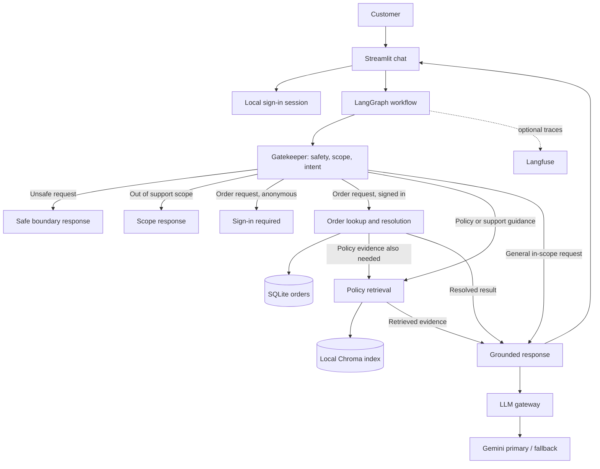
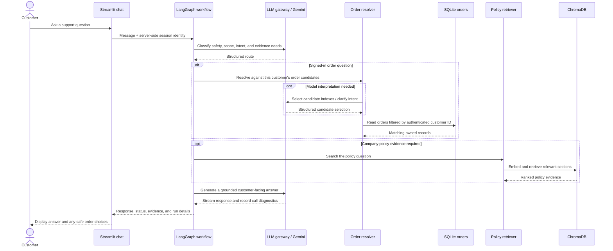

# Customer Support Resolution Copilot

**A grounded, order-aware customer support assistant** that combines authenticated order lookup with company-policy retrieval. Ask naturally about purchases, delivery status, returns, warranties, or troubleshooting; the application routes each request to the data and evidence it needs.

[](https://www.python.org/)
[](https://streamlit.io/)
[](https://www.langchain.com/langgraph)
[](https://ai.google.dev/)
[](https://www.trychroma.com/)

## What it does

The Copilot answers two kinds of support questions in one conversation:

- **Questions about a customer's own orders:** find, list, filter, sort, compare, and explain records belonging to the signed-in customer.
- **Questions that need company knowledge:** retrieve relevant policy sections and use them to answer questions about returns, refunds, warranties, procedures, and troubleshooting.

It can combine both sources—for example, identify a customer's purchase, then retrieve the return policy that applies. Answers are generated from the order data and policy evidence available to the workflow. When a record is ambiguous, the app asks the customer to choose from a short list instead of silently guessing.

The application provides **information and guidance**. It does not execute refunds, cancellations, address changes, account deletion, or other sensitive actions.

## At a glance

| Area | Implementation |
| --- | --- |
| Chat interface | Streamlit, with streamed responses, conversation history, order-choice buttons, and expandable run details |
| Workflow | Conditional LangGraph graph for safety checks, intent routing, order resolution, policy retrieval, and response generation |
| Language models | Google Gemini through a retrying gateway with a configurable fallback model |
| Order data | Local SQLite database with authenticated, customer-scoped, read-only order queries |
| Policy search | ChromaDB and sentence-transformer embeddings; optional hybrid BM25 retrieval and reranking |
| Authentication | Local demo accounts, Argon2 password hashes, session expiry, and process-local failed-login lockout |
| Tracing | Optional Langfuse tracing; disabled when credentials are blank |

## How a request flows



The sequence below shows how one customer turn moves through the app. The resolver may use fast paths for clear requests; it asks the model to interpret a reference only when needed.



1. The **Gatekeeper** classifies whether a request is safe, in scope, about the customer's own records, and whether policy evidence is needed.
2. The workflow follows a conditional route. Anonymous users can ask general support and policy questions; customer-specific order lookup requires sign-in.
3. The order resolver turns a natural-language request into structured, schema-checked filters, sorting, requested fields, and/or a clarification request. The application—not the model—executes the query.
4. When needed, policy retrieval searches locally indexed policy sections. The response can then cite the retrieved section in the app's expandable **Sources** panel.
5. The response streams into the chat. Run details can show workflow steps, status, latency, model attempts, fallback use, and token counts.

## What customers can ask

### Find and understand orders

Customers can ask for an order by its identifier, product, variant, status, or date; refer to an order from earlier in the conversation; or ask to list all their orders. They can also request records matching several conditions, sort results, select a relative position such as “latest” or “third oldest,” or ask to see specific available fields.

The resolver supports schema-approved text, numeric, date, and boolean fields. Its filter operators include equality and inequality, membership, text containment, numeric comparisons and ranges, date comparisons and ranges, null checks, and nested `AND`, `OR`, and `NOT` expressions. The server validates requested fields and operators against the live database schema before querying.

Examples:

- “Where is order 7002?”
- “Show my delivered coffee makers from September.”
- “Which of my orders is the most expensive?”
- “Show my orders where quantity is greater than one, sorted by price from low to high.”
- “I meant the silver one.”

### Ask company-policy and product-support questions

Policy questions use retrieved knowledge-base passages rather than relying only on model memory. Retrieval is section-aware in its metadata, and the app exposes retrieved source sections in the UI so a user can inspect the evidence behind a response.

Examples:

- “What is the return process?”
- “How does the warranty work?”
- “How should I troubleshoot a damaged item?”
- “Can I return the coffee maker I ordered?”

The last example can require both the customer's order and the relevant policy.

### Get a safe clarification when needed

Similar products, incomplete dates, typos, or multiple matching purchases can be ambiguous. The workflow can ask a follow-up and show up to four order choices. A selected choice is checked again against the signed-in customer's own orders before it becomes the active order context.

## Design and safety boundaries

- **Customer-scoped reads:** order queries bind to the authenticated customer ID and read the SQLite database in read-only mode. A supplied order ID is checked against that customer's records.
- **Model output is not executable:** the model returns structured intent; Python validates the schema fields, filter operators, selected order, and candidate options before accessing data. The model never writes SQL or Python for execution.
- **Untrusted text stays data:** product names, database values, and customer messages are not treated as instructions. Resolver prompts avoid including order IDs and account identifiers; the server maps selected candidate indexes back to actual records.
- **Ambiguity is explicit:** invalid or uncertain model output does not expand access. The resolver can return a safe no-match result or ask the customer to choose among visible, owned records.
- **Sensitive actions are out of scope:** the assistant can explain a process but does not carry out a refund, cancel an order, change an address, or perform another irreversible operation.
- **Demo authentication has limits:** passwords are Argon2-hashed, failed attempts are temporarily locked out in the running process, and sessions expire after inactivity. This local demo authentication is not a substitute for a production identity provider or persistent distributed rate limiting.

## Resilience and observability

All model calls use the LLM gateway. It applies per-model timeouts, bounded attempts, a total deadline, error classification, and a configurable fallback. When the primary model is rate-limited or unavailable, it can use the fallback; a temporarily unhealthy primary is cooled down and can be retried after recovery. The interface records model attempts and whether a fallback was used.

The run-details expander also reports end-to-end latency, workflow-node timings, LLM call counts, token usage, retrieval/order/response statuses, and errors. With optional Langfuse credentials configured, the app attaches traces to a session. A user ID is sent to Langfuse only as a salted pseudonymous identifier when a salt is configured.

## Architecture

| Path | Responsibility |
| --- | --- |
| `app.py` | Streamlit UI, login form, chat state, streaming, order-choice buttons, source and run-detail panels |
| `agents/` | LangGraph state, prompts, nodes, conditional routes, response formatting, and event recording |
| `auth/` | Local authentication, session lifecycle, idle timeout, and chat-state clearing on logout |
| `tools/orders.py` | Safe order schema discovery and customer-scoped SQLite reads |
| `tools/order_resolver.py` | Validated filtering, sorting, position selection, and ambiguity handling |
| `tools/indexer.py` | Deterministic policy chunking and Chroma index updates |
| `tools/retriever.py` | Semantic retrieval plus optional hybrid ranking and reranking |
| `llm/` | Gemini provider construction, retries, deadlines, fallback, and safe call diagnostics |
| `observability/langfuse.py` | Optional trace creation, session configuration, pseudonymous IDs, and flush handling |
| `config/` | Environment-backed settings and repository-relative local data paths |
| `scripts/` | Local demo-user/order seeding and the migration entry point |
| `data/company_knowledge_base.txt` | Policy source indexed for retrieval |

## Get started

### Requirements

- Python 3.11 or newer
- A Google Gemini API key
- Network access for Gemini calls and the first embedding-model download

### 1. Clone and install

```bash
git clone https://github.com/Viraj5216/customer-support-copilot.git
cd customer-support-copilot
python3 -m venv .venv
source .venv/bin/activate
python -m pip install --upgrade pip
python -m pip install -r requirements.txt
```

### 2. Configure Gemini

```bash
cp .env.example .env
```

Edit `.env` and replace `GEMINI_API_KEY` with your own key. Do not commit `.env` or share API keys.

### 3. Create local demo data and policy index

```bash
python -m scripts.seed_demo_users
python -m tools.indexer
```

The seed command creates four synthetic demo accounts and sample orders in the local SQLite database. It generates unique passwords and writes them to `data/demo_credentials.txt` for local sign-in. **That file is private local data and is ignored by Git.** The indexer reads the tracked policy file, creates or opens the local Chroma collection, and indexes its policy sections. The first run downloads the configured sentence-transformer embedding model.

### 4. Start the app

```bash
streamlit run app.py
```

Open the local URL printed by Streamlit. Sign in with one of the generated demo accounts from `data/demo_credentials.txt` to try customer-specific order questions. General policy and support questions are also available without sign-in.

## Configuration

All settings are read from `.env`; `.env.example` contains the supported starting values.

| Variable | Purpose |
| --- | --- |
| `GEMINI_API_KEY` | Required key for Gemini model calls |
| `GEMINI_MODEL` | Primary model (example default: `gemini-3.5-flash-lite`) |
| `GEMINI_FALLBACK_MODEL` | Optional fallback model (example default: `gemini-3.1-flash-lite`) |
| `LLM_PRIMARY_TIMEOUT_SECONDS`, `LLM_TIMEOUT_SECONDS`, `LLM_STREAM_TIMEOUT_SECONDS` | Primary and streaming timeouts |
| `LLM_FALLBACK_TIMEOUT_SECONDS`, `LLM_FALLBACK_STREAM_TIMEOUT_SECONDS` | Fallback model timeouts |
| `LLM_MAX_ATTEMPTS_PER_MODEL`, `LLM_TOTAL_DEADLINE_SECONDS` | Retry bound and total request deadline |
| `LLM_RETRY_INITIAL_BACKOFF_SECONDS`, `LLM_RETRY_MAX_BACKOFF_SECONDS` | Bounded exponential backoff for retryable errors |
| `LLM_MODEL_FAILURE_THRESHOLD`, `LLM_MODEL_COOLDOWN_SECONDS` | Transient-failure circuit breaker threshold and cooldown |
| `RETRIEVAL_MAX_DISTANCE`, `RETRIEVAL_HIGH_CONFIDENCE_DISTANCE` | Retrieval relevance thresholds |
| `RAG_SECTION_AWARE_EMBEDDINGS` | Include section context in embedding text when enabled |
| `RAG_HYBRID_ENABLED` | Combine semantic results with BM25 keyword ranking |
| `RAG_RERANKER_ENABLED`, `RAG_RERANKER_MODEL` | Enable a cross-encoder reranking pass and choose its model |
| `ORDERS_DB_REL_PATH`, `CHROMA_DB_REL_PATH`, `POLICIES_FILE_REL_PATH` | Local database, vector-store, and policy-file locations |
| `ORDER_DATE_ORDER`, `APP_TIMEZONE` | Date interpretation and application timezone |
| `AUTH_SESSION_IDLE_TIMEOUT_SECONDS` | Session idle timeout; example default is 30 minutes |
| `LANGFUSE_PUBLIC_KEY`, `LANGFUSE_SECRET_KEY`, `LANGFUSE_BASE_URL` | Optional Langfuse tracing settings |
| `LANGFUSE_USER_ID_SALT` | Optional salt for stable pseudonymous trace user IDs |

BM25 hybrid retrieval, section-aware embeddings, and reranking are disabled by default. Enabling a reranker may download its model on first use.

## Project Test Cases and Verification

Testing focused on the real risks in this support workflow: getting a customer's order right, handling ambiguity safely, protecting customer data, and recovering when a model is unavailable.

### Fresh-install checks

The fresh-install checks passed:

- Database seeding created four demo users and 13 sample orders.
- Running the seed process a second time did not create duplicates.
- The migration entry point correctly reused the seeding logic.
- A fresh ChromaDB collection was created successfully.
- The policy indexer processed 71 policy chunks.

### Order-resolution cases

The project-specific resolver cases cover:

- Finding orders by product, variant, status, date, and order ID.
- Interpreting typos, partial product names, relative dates, and follow-up references such as “the older one.”
- Listing, filtering, sorting, and selecting relative positions such as the latest or third-oldest matching order.
- Returning `FOUND`, `CLARIFY`, or `NO_MATCH` when a request is clear, ambiguous, or unsupported.
- Capping clarification choices at four and requiring confirmation when a candidate is still ambiguous.
- Ignoring duplicate or out-of-range model selections and using fast paths for clear requests.

### Safety and failure cases

Regression cases also check that:

- A clarification can select only an option already shown and validated for the signed-in customer.
- Order IDs and account identifiers are kept out of the resolver-matching prompt.
- Instruction-like text in a user message or product name cannot expand the server-side order mapping.
- Malformed structured output and model failures do not produce an unsafe order selection.
- Date resolution requires a timezone-aware clock.

### Model fallback scenarios

Offline fake-provider cases exercise four gateway paths:

1. A rate-limited primary model falls back to the secondary model.
2. A primary model in cooldown is skipped.
3. The gateway switches back to the primary after recovery.
4. A simulated HTTP 503 triggers fallback.

### 50-case order scenario set

A synthetic 50-case set covers product aliases and typos, order variants and statuses, exact and relative dates, follow-up references, ambiguity, unsupported products, and instruction-like text. Its expected outcomes are 35 `FOUND`, 10 `CLARIFY`, and 5 `NO_MATCH`. These are scenario labels, not a live-model accuracy score.

The test and evaluation files remain local and are not included in this source-only repository; this section summarizes the project-specific coverage used during development.

## Local files and Git hygiene

The repository tracks application code, setup scripts, requirements, `.env.example`, and the policy source. It intentionally excludes `.env`, demo credentials, SQLite databases, Chroma stores, caches, tests, evaluation datasets/results/scripts, and OS metadata. These files are generated or kept locally and must not be committed.

The old Git history is preserved separately from the working project. The current GitHub repository starts with the reviewed source-only snapshot.

## Troubleshooting

- **The app says `GEMINI_API_KEY is not set`:** confirm `.env` exists in the project root and contains a real `GEMINI_API_KEY` value.
- **A policy index is missing or stale:** activate the virtual environment and rerun `python -m tools.indexer`.
- **No demo user can sign in:** rerun `python -m scripts.seed_demo_users` and check the generated `data/demo_credentials.txt` file; do not publish or share its passwords.
- **The first index run is slow:** the embedding model may need to download before policy sections can be indexed.

## License

No license has been added yet. Contact the repository owner before reusing or redistributing this project.
